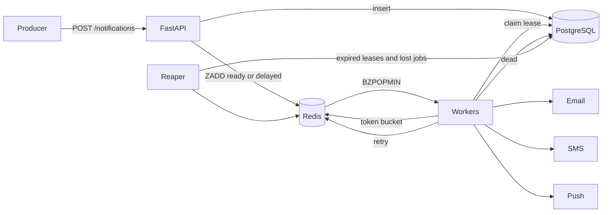

# Notification Service

A queue based multi channel notification service built with Python, FastAPI, PostgreSQL and Redis. Producers call a REST API, the API persists and enqueues, and a pool of workers delivers through email, SMS and push providers with retries, backoff, rate limits and a dead letter queue.

## Features

- Email, SMS and push channels behind a common provider interface
- Priority queues: OTP before transactional before marketing
- Idempotency through the `Idempotency-Key` header
- Retries with exponential backoff and jitter, dead letter queue with manual replay
- Per channel delivery rate limits using an atomic Redis Lua token bucket
- Per API key producer rate limit with `Retry-After`
- Templates rendered in a Jinja2 sandbox
- Per user and per category opt out preferences
- Scheduled and cancellable notifications
- Crash recovery through leases and a reaper
- Prometheus metrics, structured JSON logs, health and readiness probes

## Architecture



PostgreSQL is the source of truth. Redis only holds work pointers, so losing Redis never loses a notification: the reaper rebuilds the queue from the database.

## Quick start

```bash
docker compose up --build
```

The API listens on `http://localhost:8000` and the interactive docs are at `/docs`. Prometheus runs on `http://localhost:9090`.

Local development without Docker:

```bash
python -m venv .venv
make install
make test
```

## API

All `/api/v1` routes require the `X-API-Key` header. The default key is `dev-key`.

| Method | Path | Purpose |
| --- | --- | --- |
| POST | `/api/v1/notifications` | Create a notification, returns 202 |
| POST | `/api/v1/notifications/batch` | Create up to 100 notifications |
| GET | `/api/v1/notifications` | List with `user_id`, `status`, `channel`, `cursor`, `limit` |
| GET | `/api/v1/notifications/{id}` | Detail with attempt history |
| POST | `/api/v1/notifications/{id}/cancel` | Cancel a queued or retrying notification |
| POST | `/api/v1/templates` | Create a template |
| GET | `/api/v1/templates` | List templates |
| GET PUT DELETE | `/api/v1/templates/{name}` | Read, update, delete |
| GET PUT | `/api/v1/users/{user_id}/preferences` | Read or set opt outs |
| GET | `/api/v1/dlq` | List dead notifications |
| POST | `/api/v1/dlq/{id}/retry` | Requeue a dead notification |
| GET | `/health` `/ready` `/metrics` | Probes and metrics |

### Examples

Create a template:

```bash
curl -X POST localhost:8000/api/v1/templates -H "X-API-Key: dev-key" -H "Content-Type: application/json" \
  -d '{"name":"welcome","channel":"email","subject":"Welcome {{ name }}","body":"Hi {{ name }}"}'
```

Send with idempotency:

```bash
curl -X POST localhost:8000/api/v1/notifications -H "X-API-Key: dev-key" \
  -H "Idempotency-Key: order-1001-confirm" -H "Content-Type: application/json" \
  -d '{"user_id":"u1","channel":"email","category":"transactional","recipient":"sam@example.com","template_name":"welcome","variables":{"name":"Sam"}}'
```

Opt a user out of marketing email:

```bash
curl -X PUT localhost:8000/api/v1/users/u1/preferences -H "X-API-Key: dev-key" -H "Content-Type: application/json" \
  -d '{"preferences":[{"channel":"email","category":"marketing","enabled":false}]}'
```

## Status lifecycle

`queued` to `processing` to `sent`. Failures go `processing` to `retrying` and back through the delayed queue, then `dead` once attempts are exhausted or the provider reports a permanent error. Opted out recipients are `skipped` and user requests can end as `cancelled`.

## Configuration

| Variable | Default | Meaning |
| --- | --- | --- |
| `DATABASE_URL` | postgres on localhost | SQLAlchemy async URL |
| `REDIS_URL` | `redis://localhost:6379/0` | Redis connection |
| `API_KEYS` | `dev-key` | Comma separated accepted keys |
| `MAX_ATTEMPTS` | 5 | Attempts before dead letter |
| `BACKOFF_BASE_SECONDS` | 2 | First retry delay ceiling |
| `BACKOFF_MAX_SECONDS` | 300 | Retry delay cap |
| `LEASE_SECONDS` | 60 | Processing lease before the reaper reclaims |
| `WORKER_CONCURRENCY` | 10 | Consumers per worker process |
| `CHANNEL_RATE_EMAIL` `SMS` `PUSH` | 50 20 100 | Deliveries per minute per channel |
| `CREATE_RATE_LIMIT` | 300 | Creates per minute per API key |
| `PROVIDER_FAILURE_RATE` | 0 | Simulated transient failure probability |
| `SMTP_HOST` | empty | Real SMTP delivery when set, simulated otherwise |

## Testing

```bash
make test
make lint
```

Tests use SQLite and fakeredis with Lua support, so no external services are needed.

## Load testing

```bash
make loadtest
```

Open `http://localhost:8089`, point it at the API and watch `queue_depth` and `delivery_attempts_total` in Prometheus.

| Scenario | Users | RPS | p50 | p99 | Failures |
| --- | --- | --- | --- | --- | --- |
| Create mix | | | | | |

## Design

See [docs/DESIGN.md](docs/DESIGN.md) for requirements, estimates, trade offs, failure modes and interview questions.
