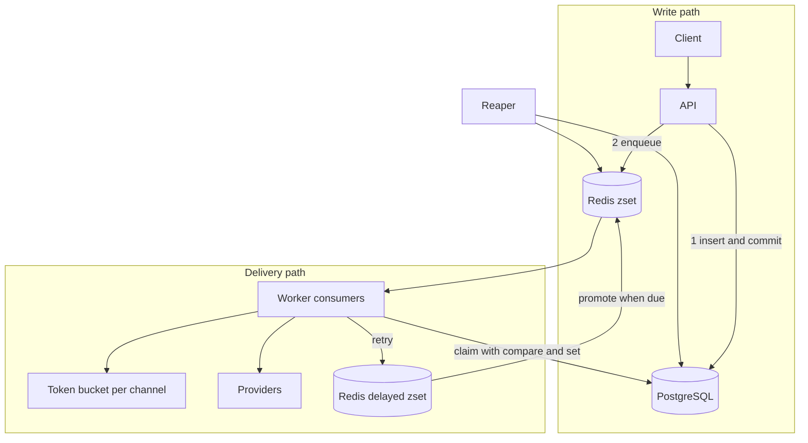

# Notification Service Design

## 1. Requirements

Functional
- Accept notification requests over REST for email, SMS and push
- Support templates, per user opt outs, scheduling, cancellation and batches
- Deliver reliably with retries and a replayable dead letter queue
- Prevent duplicate sends when producers retry

Non functional
- Accepting a request must stay fast and independent of provider latency
- At least once delivery, with duplicates suppressed at the API and claim layers
- OTP messages must not wait behind marketing bursts
- Providers must be protected from overload through per channel rate limits
- Survive worker crashes and Redis loss without losing notifications

## 2. Capacity estimates

Assume 50M notifications per day.

- Average load: 50M / 86,400 is about 580 per second, peak 5x is about 3,000 per second
- Row size around 1 KB with body and metadata, so 50 GB per day and about 18 TB per year, which means partitioning by month and archiving sent rows after 30 days
- Attempt rows: average 1.2 attempts, about 100 bytes each, 6 GB per day
- Redis holds only ids: 40 bytes per entry, 1M queued entries is about 40 MB
- Worker throughput: a worker with 10 consumers at 200 ms provider latency delivers about 50 per second, so 60 workers cover the 3,000 per second peak

## 3. Architecture

Write path: validate, render the template, check preferences, insert the row, commit, then push the id to Redis. The commit comes first so a queue entry never points at a missing row. If the push fails the row stays `queued` and the reaper enqueues it.

Delivery path: a worker pops an id, atomically claims the row with `UPDATE ... WHERE status IN (queued, retrying)`, takes a channel token, calls the provider, then records the outcome.

## 4. Data model

- `notifications`: one row per message, status, attempts, lease, schedule, idempotency key (unique)
- `notification_attempts`: append only history per attempt
- `templates`: named Jinja2 templates per channel
- `user_preferences`: composite key of user, channel, category

PostgreSQL gives transactions, unique constraints for idempotency and indexed queries by status and user. Indexes: `(status, next_attempt_at)` for the reaper, `(user_id, created_at)` for history listing.

## 5. Queue design

One Redis sorted set `queue:ready` with score `priority * 1e13 + enqueue_ms`. `BZPOPMIN` always yields the highest priority, oldest entry. A single structure gives strict priority and FIFO within a class without polling several lists.

Retries use `queue:delayed` with score equal to the due time. A promoter moves due members into the ready set every second. Members carry the priority so promotion preserves it.

Alternatives considered

| Option | Why not chosen |
| --- | --- |
| Kafka | Heavier to run, per message retry delays and priorities are awkward |
| RabbitMQ with plugins | Good fit, but adds a broker while Redis is already needed for rate limits |
| Celery | Hides the lease and idempotency semantics this project wants to show |
| Postgres only queue with SKIP LOCKED | Viable at lower scale, but polling load grows with workers |

## 6. Delivery guarantees

- At least once: the database row outlives any queue loss and the reaper recovers it
- Duplicate suppression at the API: `Idempotency-Key` backed by a unique index, with the unique violation path handling concurrent requests
- Duplicate suppression at the worker: the claim is a compare and set on status, so two copies of one queue entry deliver once
- Remaining duplicate window: a worker that sends and then crashes before committing `sent`. The lease expires and the message is sent again. Provider side idempotency keys close this gap when the provider supports them. This is the unavoidable trade of at least once delivery

## 7. Retry policy

`delay = random(ceiling / 2, ceiling)` where `ceiling = min(cap, base * 2^(attempt - 1))`. Jitter prevents synchronized retry storms after a provider outage. Permanent errors skip retries. After `MAX_ATTEMPTS` the notification becomes `dead` and can be replayed with the DLQ endpoint after the cause is fixed.

Rate limited deliveries are deferred without consuming an attempt, because throttling is our own decision and not a provider failure.

## 8. Rate limiting

Token bucket in one Lua script, so refill, check and consume happen atomically across all workers and API nodes. Keys: `rl:channel:{channel}` protects providers, `rl:producer:{key}` protects the service from a single noisy client. If Redis is down the limiter fails open and logs a warning, favoring availability of the API over strict throttling.

## 9. Failure modes

| Failure | Effect | Recovery |
| --- | --- | --- |
| Redis down | API still accepts and stores, queue push fails, limiter fails open | Reaper re-enqueues stale `queued` rows when Redis returns |
| Redis data loss | Queue and delayed entries vanish | Reaper rebuilds from rows in `queued` and `retrying` |
| PostgreSQL down | API returns 5xx, workers back off | Readiness probe fails, retried by clients |
| Worker crash mid send | Row stuck in `processing` | Lease expires, reaper moves it to `retrying` or `dead` |
| Provider outage | Transient errors | Backoff with jitter, then dead letter |
| Poison message | Permanent error | Dead immediately, visible in DLQ |
| Duplicate producer request | Same idempotency key | Original row returned with `Idempotent-Replayed` |
| Marketing flood | Large queue | Priority score keeps OTP ahead, channel limits protect providers |

## 10. Scaling

- API and workers are stateless and scale horizontally
- Partition `notifications` by month, archive sent rows
- Shard Redis queues by channel or by hash of id when a single instance saturates
- Read replicas for listing endpoints
- Separate worker pools per channel so a slow SMS provider cannot starve email

## 11. Observability

- `/metrics`: created, skipped, delivery attempts by outcome, delivery latency, dead letters, queue depth, delayed depth, reaped counts, HTTP latency
- Structured JSON logs with a request id bound to every line
- Alerts worth setting: queue depth growth, dead letter rate, p99 delivery latency, reaper recoveries above zero for long periods

## 12. Trade offs

- Redis sorted set instead of a broker keeps the stack small but offers no consumer groups, the database claim covers that gap
- Simulated providers keep the project runnable anywhere, the provider interface isolates real vendors
- Preferences never block OTP because security flows must still work for opted out users
- Templates render at accept time so the stored message is exactly what was approved and later template edits do not change queued messages

## 13. Interview questions

1. How do you avoid sending the same notification twice? Idempotency key at the API, compare and set claim at the worker, lease based recovery, and provider idempotency keys for the residual window.
2. Exactly once or at least once? At least once, because exactly once across a network call to a provider is not achievable. Duplicates are minimized and made idempotent.
3. How do you prioritize OTP over marketing? Priority is encoded in the sorted set score so `BZPOPMIN` always returns the highest priority first.
4. What if a worker dies after sending? The lease expires, the reaper requeues, and the message may be sent twice unless the provider dedupes.
5. What if Redis loses everything? PostgreSQL is the source of truth and the reaper rebuilds the queue.
6. Why jitter in backoff? To stop many failed messages retrying at the same instant and hammering a recovering provider.
7. How do you handle a provider rate limit? A shared token bucket per channel, with deferral that does not consume attempts.
8. Why is the token bucket a Lua script? Redis runs it atomically, so concurrent workers cannot overspend tokens.
9. How would you scale to ten times the load? More workers, per channel pools, queue sharding, partitioned tables and read replicas.
10. How do you replay failures? The DLQ endpoint resets attempts and requeues once the underlying issue is fixed.
11. Why persist before enqueue? A queue entry must never reference a row that does not exist, and a failed enqueue is recoverable from the database.
12. How do you cancel a scheduled message? Compare and set to `cancelled` on queued or retrying rows and remove it from both Redis sets, workers skip anything not claimable.
